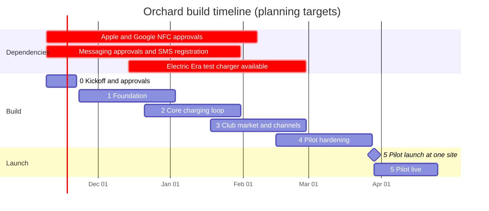

# Orchard Wallet: Technical Rundown and Build Timeline

Companion to [`orchard-wallet-user-stories.md`](orchard-wallet-user-stories.md), which holds the product decisions and user stories. This document covers how to build it and in what order.

**Status:** planning draft. Estimates are rough and depend on team size and on third parties (Apple, Google, the messaging provider, Electric Era). Anything about a platform's rules is written from general knowledge and must be confirmed with that platform before it is relied on.

---

## 1. What we are building

A no-app experience for EV drivers at Electric Era chargers:

* The driver signs up on a web page, links their wallet's default card, and adds an **Orchard card** to Apple Wallet or Google Wallet.
* Tapping the card on the charger starts a session. Tapping it at the club door opens the door. Tapping it at the micro market pays.
* Every charging session includes a flat **$3 club access fee**. The driver's saved card is charged **after** the session completes.
* Orchard talks to the driver through business messaging (Apple Messages for Business, Google RCS Business Messaging) with SMS as the fallback: charging started, 80% reminder, charging complete, and answers to "charging history", "total spend", and so on.
* After every session Orchard creates a private session page and sends its link.
* Staff manage accounts in an internal dashboard.

## 2. Architecture overview

```
 Driver phone                         Electric Era                  Club / market
 ┌──────────────┐  tap (NFC)     ┌────────────────────┐        ┌──────────────────┐
 │ Wallet pass  │───────────────▶│ Charger + backend  │        │ Door NFC reader  │
 └──────┬───────┘                └─────────┬──────────┘        │ Market POS       │
        │ messages / links                 │ authorize tap,    └────────┬─────────┘
        ▼                                  │ session events,            │ allow/deny,
 ┌──────────────┐                          │ SOC, stop session          │ purchases
 │ Apple / RCS  │                          ▼                            ▼
 │ / SMS        │◀───────────────────────────────────────────────────────────────┐
 └──────────────┘                ┌────────────────────────────────────────┐      │
        ▲                        │               ORCHARD BACKEND          │      │
        │                        │  Account · Pass · Session engine ·     │──────┘
 ┌──────┴───────┐                │  Billing · Messaging · Pages · Door ·  │
 │ Web pages    │◀───────────────│  Market · Staff dashboard API          │
 │ (signup,     │                └───────┬──────────────────┬─────────────┘
 │ session)     │                        │                  │
 └──────────────┘                  Postgres + queue      Stripe
```

Everything driver-facing is either a **web page**, a **wallet pass**, or a **message**. There is no mobile app.

## 3. Components

| # | Component | Responsibility |
|---|---|---|
| 1 | **Web (signup + session pages)** | Mobile-first pages: signup with fee disclosure, phone verification, card linking (Stripe), wallet add buttons, per-session page, fallback login. Static front end plus API. |
| 2 | **Account service** | Accounts keyed by verified phone number, user type (public/fleet), status, channel identities, consent records. |
| 3 | **Pass service** | Issues and updates Apple Wallet passes (PassKit web service) and Google Wallet passes. The pass carries only an ID. NFC enablement depends on platform approval. |
| 4 | **Electric Era integration** | Inbound: tap/authorize requests, `session_started`, state of charge, `session_completed`. Outbound: stop session. Includes retries, signature checks, idempotency, and a nightly reconciliation against their sessions. |
| 5 | **Session engine** | State machine per session: `authorized → started → charging → completed → settled` (or `payment_failed`). Triggers messages at each step. |
| 6 | **Billing (Stripe)** | Saves the wallet card (Apple Pay / Google Pay) for later charges, charges after the session as an off-session payment, handles failures and refunds. One charge per session via an idempotency key. |
| 7 | **Messaging service** | One interface over Apple Messages for Business, RCS Business Messaging, and SMS (through a provider). Templates, delivery status, fallback to SMS, opt-out handling. |
| 8 | **Inbound message router ("Ask Orchard")** | Receives driver messages, identifies the account, maps them to a fixed set of read-only requests (history, spend, usage, receipt, link, update card, help), replies from Orchard's records. Optional AI for free-form wording that only picks a request. |
| 9 | **Page generator** | Creates the session page after settlement, issues a random link, handles expiry and revocation. |
| 10 | **Door access service** | Answers the NFC reader's "may this pass enter?" with allow/deny in under a second. Logs every tap. |
| 11 | **Micro market (POS) integration** | Receives purchases tied to the pass, charges the saved card, records items for receipts and the "Purchased" and in-store-spend lines. |
| 12 | **Staff dashboard** | Search by phone/name/email, view sessions, door taps, purchases, failures; change user type or phone number; refund via Stripe; suspend; revoke links. Role-based access and an audit log. |
| 13 | **Platform/ops** | Hosting, secrets, monitoring, alerting, logging, backups, CI/CD. |

## 4. Key flows

**Signup**
1. Driver enters name, phone, email, optional fleet code, ticks the agreement (texts, charge after each session, $3 access fee).
2. Code sent by SMS; driver verifies. Account created.
3. Driver authorizes Apple Pay or Google Pay; Stripe saves the card for later charges.
4. Driver adds the Orchard card to their wallet (pass issued) and opens the Orchard conversation (links the messaging identity to the account).

**Tap to charge**
1. Driver taps the pass. Electric Era's charger sends the pass ID to Orchard's authorize endpoint.
2. Orchard checks: account active, card saved and valid. Returns allow/deny (and a reason). The tap is logged.
3. On allow, Electric Era starts the session and sends `session_started`. Orchard sends "charging started" (with the club note).

**During the session**
* Electric Era sends state of charge. At the threshold (default 80%) Orchard sends the reminder. A "STOP CHARGING" reply calls Electric Era's stop-session API.
* The door reader asks Orchard "may pass X enter?" Allowed while the account has an active session.

**Settlement**
1. `session_completed` arrives (kWh, times).
2. Total = charging amount (if Orchard bills it) + $3 access fee.
3. Orchard creates one off-session Stripe payment for the total, idempotency key = session ID.
4. On success: mark `settled`, generate the session page, send "charging complete" with the link, email the receipt.
5. On failure: mark `payment_failed`, notify the driver with a link to update the card, flag in the dashboard, retry on a schedule (to decide).

**Ask Orchard**
Driver message → provider webhook → identify account (sender's number, or the linked Apple conversation) → match request → reply from the database → log.

## 5. Data model (sketch)

| Table | Key fields |
|---|---|
| `accounts` | id, phone (unique), name, email, user_type, status, created_at |
| `consents` | account_id, type (messaging, terms, access_fee), text_version, accepted_at, ip |
| `channel_identities` | account_id, channel (apple, rcs, sms), external_id, verified_at, opted_in |
| `passes` | account_id, platform, serial, status, last_updated |
| `payment_methods` | account_id, stripe_customer_id, stripe_pm_id, brand, last4, status |
| `sites`, `chargers` | site, charger, club_available |
| `sessions` | id, account_id, charger_id, started_at, ended_at, kwh, state, last_soc |
| `charges` | session_id or purchase_id, type (charging, access_fee, market), amount, stripe_pi_id, status |
| `purchases` | account_id, pos_ref, items, amount, created_at |
| `door_events` | account_id, reader_id, result, reason, ts |
| `session_pages` | session_id, token_hash, expires_at, revoked_at |
| `message_log` | account_id, direction, channel, template/intent, status, ts |
| `staff_users`, `audit_log` | staff, role; who did what, when |

Money amounts are stored as integer cents. Tokens are stored hashed. Card numbers are never stored by Orchard (Stripe holds them).

## 6. Third-party integrations

| Integration | Needed for | Notes / dependencies |
|---|---|---|
| **Electric Era** | Tap, authorize, session events, SOC, stop session, sites list, test environment | The most important dependency. Spec the requirements early (see the user stories doc). |
| **Apple Wallet / Google Wallet** | Orchard card pass, NFC taps | NFC-enabled passes need platform approval (Apple VAS / NFC entitlement, Google Smart Tap). Long lead time. |
| **Stripe** | Saving the wallet card, off-session charges, refunds, update-card links | Confirm the Apple Pay / Google Pay saved-card setup for later charges. |
| **Messaging provider** | Apple Messages for Business, RCS Business Messaging, SMS | Business verification, platform approval, carrier registration (A2P 10DLC) for SMS. Apple does not provide the phone number. |
| **Door reader / controller** | Club entry | Must read Apple VAS and Google Smart Tap passes. Needs a local fallback if the network is down. |
| **Micro market POS** | Purchases, receipts | Needs an API, or a reader that can report the pass ID and basket. |
| **Email provider** | Receipts | Standard transactional email. |

## 7. Security, privacy, and compliance

* **Payments:** card data only ever touches Stripe, which keeps Orchard's PCI scope small. No card entry on Orchard pages.
* **Session pages:** random unguessable links (store only a hash), expiry, revocation, `noindex`, no full card number or email shown, phone masked.
* **Identity by phone:** phone numbers can be spoofed or taken over. Anything that changes money or account details goes through a secure link or staff, never a bare message.
* **Messaging consent:** record opt-in with wording and timestamp; honor STOP/HELP on every channel; follow TCPA and carrier rules.
* **Fee disclosure:** the $3 access fee shown before consent (signup page), on receipts, and on the charger; confirm what the state requires for disclosing mandatory fees.
* **Staff access:** roles, least privilege, audit log, SSO if available.
* **Data:** encryption in transit and at rest, retention policy, deletion on request, backups.
* **Legal review before launch:** terms and fee disclosure, messaging consent, refunds for short or failed sessions, privacy policy.

## 8. Non-functional requirements

* **Door and tap latency:** allow/deny under 1 second end to end. The door controller keeps a local allow-list so that a network outage does not lock drivers out.
* **Reliability:** all inbound events are idempotent (event ID), retried, and reconciled nightly against Electric Era's session data.
* **No double charging:** one payment per session via an idempotency key; settlement is safe to re-run.
* **Observability:** logs, metrics, and alerts for failed taps, failed settlements, undelivered messages, and webhook backlogs.
* **Accessibility:** pages usable on phones, keyboard and screen-reader friendly, readable in dark mode.

## 9. Suggested stack (adjust to the team)

* **Backend:** TypeScript (Node) or the language the team knows best; REST/webhooks; a job queue for settlement, messages, and retries.
* **Database:** Postgres.
* **Front end:** lightweight server-rendered or a small SPA for signup and session pages; the prototypes in `prototype/` show the intended screens.
* **Hosting:** a managed platform (containers or serverless) with managed Postgres and secrets.
* **Observability:** hosted logging and error tracking.
* **Provider choices:** Stripe (payments); a messaging provider that supports Apple Messages for Business, RCS, and SMS; a wallet pass library or service for Apple and Google passes.

---

## 10. Build timeline

### Assumptions

* Team of about **4**: two backend engineers, one full-stack/front-end engineer, and a part-time designer and QA/devops. A smaller team stretches every phase.
* Planning starts the week of **Nov 9, 2026**. Holiday weeks are included as slack.
* The target is a **pilot at one site** with real drivers, then a wider launch.
* Calendar dates below are planning targets, not commitments. Third-party approvals can move them.

### Phases

| Phase | Weeks | Dates | Outcome |
|---|---|---|---|
| **0. Kickoff and approvals** | 1-2 | Nov 9 - Nov 22 | Submit Apple and Google NFC pass applications, Apple Messages for Business and RCS registration, SMS carrier registration, Stripe setup. Choose messaging provider, door reader, and POS. Agree Electric Era's integration spec and test environment. Start legal review. |
| **1. Foundation** | 3-8 | Nov 23 - Jan 3 | Account service, signup with fee disclosure, phone verification, Stripe card saving, dashboard skeleton, SMS messaging, pass issuing (without NFC if still pending), simulators for Electric Era events and taps. |
| **2. Core charging loop** | 7-12 | Dec 21 - Jan 31 | Tap authorization, session engine, settlement (charge after the session), session pages, receipts, "Ask Orchard" requests, 80% and charging-complete messages. Built against simulators, then Electric Era's test environment as it becomes available. |
| **3. Club, market, and channels** | 11-16 | Jan 18 - Feb 28 | Door access service and reader, micro market purchases and receipts, Apple Messages and RCS channels with SMS fallback, staff dashboard completed (refunds, revoke links, failures). |
| **4. Pilot hardening** | 15-20 | Feb 15 - Mar 28 | End-to-end tests on a real Electric Era charger, door, and market. Security review, load and failure testing, accessibility pass, legal sign-off. Staff and friendly-user trial. |
| **5. Pilot launch** | 21-24 | Mar 29 - Apr 25 | One site live with real drivers, daily monitoring, fixes, measure drivers reaching the club and complaint rates. |
| **6. Expand** | 25+ | May onward | More sites, fleet onboarding, refinements from pilot data. |



### Critical path

The build itself is not what sets the date. These do:
1. **Apple and Google NFC pass approval.** Without it, the wallet card cannot be tapped on chargers or the door.
2. **Electric Era's chargers and test environment.** We cannot test tap-to-charge end to end until they have a charger that reads the pass and sends session events.
3. **Messaging approvals** (Apple Messages for Business, RCS, SMS registration). SMS is the safe fallback while the others complete.
4. **Door reader and micro market POS** hardware and API.

Start all four in week 1. If any of them slips, the pilot date moves by about the same amount.

### Milestones

| Milestone | Target | Done when |
|---|---|---|
| **M1: Approvals submitted** | End of week 2 | All applications filed, providers chosen, Electric Era spec agreed |
| **M2: Signup works** | End of week 8 | A tester can sign up, verify, link a card, and receive a pass (non-NFC acceptable) |
| **M3: Simulated session end to end** | End of week 12 | A simulated tap and session produces a charge, a session page, and the messages |
| **M4: Real charger end to end** | End of week 16 | A real tap on an Electric Era charger completes the full loop on a test account |
| **M5: Club and market live in test** | End of week 16 | Door tap allows/denies correctly; market purchase charges and receipts |
| **M6: Pilot ready** | End of week 20 | Security review, legal sign-off, and staff trial complete |
| **M7: Pilot live** | Week 21 | One site open to real drivers |

### Fallbacks if something slips

* **NFC pass approval late:** pilot with a physical NFC or RFID card that the chargers and door already read, and swap in the wallet pass when approved.
* **Apple Messages or RCS approval late:** launch on SMS; the rest of the system is unchanged.
* **Electric Era cannot send state of charge:** drop the 80% reminder from the pilot and keep "charging complete".
* **Market POS integration late:** pilot without market purchases; the session page and texts still work.

## 11. Risks

| Risk | Impact | Mitigation |
|---|---|---|
| Platform approvals take longer than planned | Pilot date slips | Apply in week 1; keep SMS and physical-card fallbacks |
| Electric Era's chargers cannot read wallet passes or send needed events | Core flow blocked | Make requirements part of the build agreement; confirm in week 1-2 |
| Saved wallet card cannot be charged later without the driver | Payment model breaks | Confirm with Stripe in week 1; fall back to a standard card-entry link |
| Drivers dislike the automatic $3 fee | Complaints, chargebacks | Prominent disclosure, clear receipts, a policy for short or faulted sessions, monitor in the pilot |
| Link-based pages shared or forwarded | Others see a session total | Minimal data on the page, expiry, revoke option, no sensitive fields |
| Messaging spoofing or SIM swaps | Account info leaked by text | Read-only requests, no sensitive data in replies, secure links for changes |
| Door network outage | Drivers locked out | Local allow-list on the door controller |
| Small card charges (micro market) have high processing fees | Margin loss | Combine a visit's purchases into one charge (decision pending) |
| Team size smaller than assumed | Longer timeline | Cut scope to the fallbacks above; move phases 3 and 4 later |

## 12. Decisions needed soon

1. **Team and budget:** confirm how many people can work on this, so the phase lengths can be firmed up.
2. **Who bills for electricity:** Electric Era or Orchard.
3. **Messaging provider** and whether to go ahead with Apple Messages for Business and RCS in the pilot or launch on SMS first.
4. **Door reader and micro market POS** vendors.
5. **Pilot site** and its opening date target.
6. **Session page link lifetime** (e.g. 30 days) and the retry policy for failed card charges.
7. **Policy for short or faulted sessions** and the $3 access fee (refund or waive).
8. **Micro market charging:** one charge per purchase or combined per visit.
